

  <picture>
    <source media="(prefers-color-scheme: dark)" srcset="docs/brand/banner-dark.png">
    
  </picture>

<h1 align="center">SkMate IPTV для Smart TV</h1>

<b>Бесплатный IPTV-плеер с открытым кодом для телевизоров Samsung (Tizen) и LG (webOS).</b> 
M3U и Xtream Codes, телегид (EPG), архив передач, профили. Управление пультом, без рекламы и аккаунтов. 
Та же программа, что и <a href="https://github.com/swensi17/skmate-iptv">SkMate для Android TV, Google TV и Fire TV</a>: те же экраны, функции и настройки.

  
  
  
  
  
  
  
  

<b>Русский</b> · <a href="docs/README.en.md">English</a>

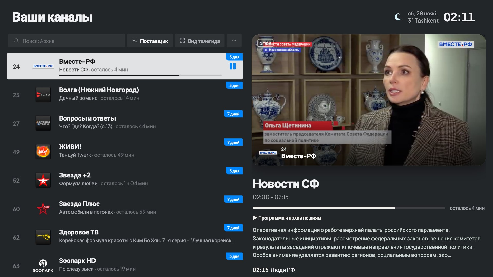

## Скачать

<table align="center">
  <tr>
    <td align="center" valign="top" width="33%">
      <a href="https://github.com/swensi17/skmate-tv/releases/latest/download/SkMate-IPTV-tizen.wgt">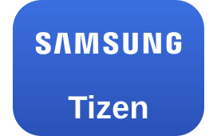</a> 
      Samsung, Tizen 4.0 и новее <code>.wgt</code> · <a href="docs/install-samsung.md">установка</a>
    </td>
    <td align="center" valign="top" width="33%">
      <a href="https://github.com/swensi17/skmate-tv/releases/latest/download/SkMate-IPTV-webos.ipk">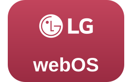</a> 
      LG, webOS 4.0 и новее <code>.ipk</code> · <a href="docs/install-lg.md">установка</a>
    </td>
    <td align="center" valign="top" width="33%">
      <a href="https://github.com/swensi17/skmate-iptv/releases/latest/download/SkMate-IPTV.apk">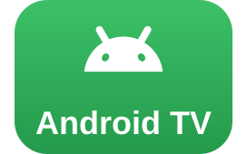</a> 
      Android TV, Google TV, Fire TV <code>.apk</code> · <a href="https://github.com/swensi17/skmate-iptv">репозиторий</a>
    </td>
  </tr>
</table>

Все выпуски и контрольные суммы SHA-256: [Releases](https://github.com/swensi17/skmate-tv/releases).

## Устройства

| Платформа | Версии | Файл | Как ставится |
|:--|:--|:--|:--|
| Samsung Smart TV | Tizen 4.0 и новее (модели с 2018 года) | `SkMate-IPTV-tizen.wgt` | через TizenBrew, около 10 минут один раз |
| LG Smart TV | webOS 4.0 и новее | `SkMate-IPTV-webos.ipk` | через режим разработчика и webOS Dev Manager, около 15 минут |
| Android TV, Google TV, Fire TV | Android 8.0 и новее | `SkMate-IPTV.apk` | файлом, как обычное приложение |

## Возможности

**Источники**
- M3U и M3U8 по ссылке, Xtream Codes, несколько плейлистов.
- Автоматическое обновление плейлиста: при запуске или каждые 2, 6, 12, 24 или 48 часов, и кнопка «Обновить сейчас».
- Группы провайдера, избранное, недавно просмотренные.

**Телегид и архив**
- XMLTV из шапки плейлиста (`url-tvg`) и свои источники, `.xml` и `.xml.gz`.
- Программа привязывается к каналу по `tvg-id`, а без него по названию. У каждого канала один телегид: верхний в списке источников, где есть передачи.
- Автоматическое обновление телегида: при запуске или каждые 1, 3, 6, 12, 24 или 48 часов. После обновления плейлиста телегид обновляется сам.
- Сетка передач по всем каналам.
- Программа канала по ▶ колонкой рядом со списком: дни справа, архив на всю глубину, которую хранит провайдер (до 7 дней). OK на прошедшей передаче включает запись.

**Плеер**
- Прямой эфир встроенным проигрывателем телевизора (HLS, MPEG-TS), запасные hls.js и mpegts.js.
- Информация о передаче, ряд недавно просмотренных каналов, кнопки управления: телегид, каналы, история, избранное, формат, таймер сна.
- Шкала перемотки |◀ ◀◀ ⏸ ▶▶ ▶| и возврат в эфир на каналах с архивом.
- Список каналов и категории поверх эфира: список меняется сам, когда курсор задерживается на категории, картинка не прерывается.
- Звуковые дорожки и субтитры, сведения о потоке (разрешение, кадры, кодек, скорость).

**Интерфейс**
- Сделан под пульт: всё доступно стрелками и OK, фокус всегда виден.
- Категории без OK: список каналов меняется вслед за курсором.
- При запуске курсор стоит на том же канале и в той же категории, где был при выходе.
- Тёмная и светлая темы, масштаб, 24 языка. Профили и PIN-код на категории.
- На LG можно включить запуск вместе с телевизором: сразу откроется последний канал.

## Скриншоты

**Каналы и программа**

| | |
|:-:|:-:|
|  | 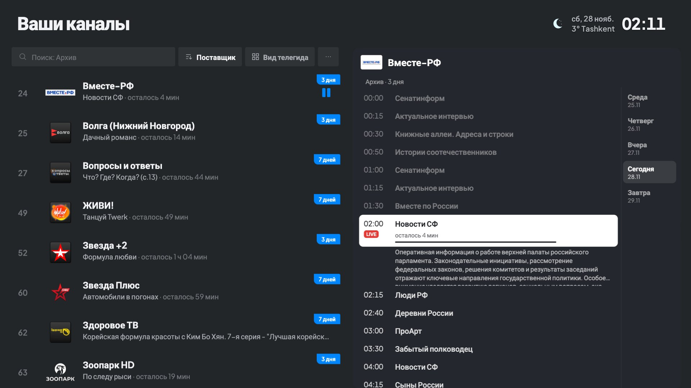 |
| Список каналов, предпросмотр и передача в эфире | Программа канала колонкой рядом со списком |
| 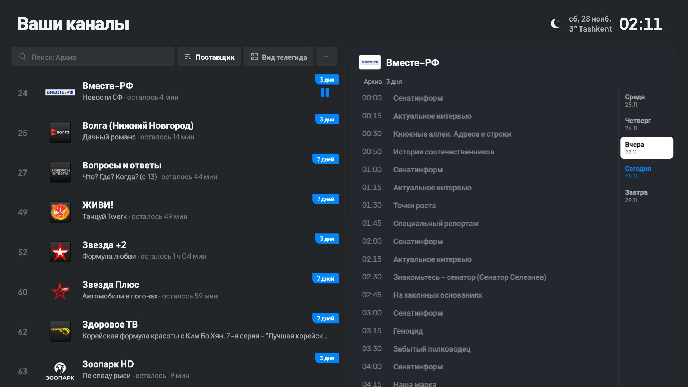 | 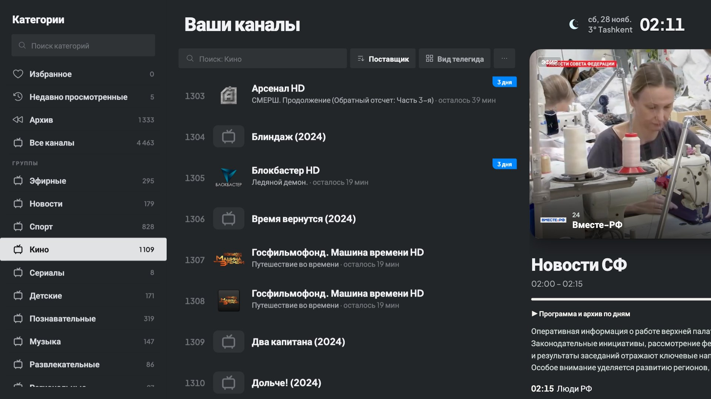 |
| Дни архива справа от передач | Категории: список меняется без OK |

**Телегид**

| | |
|:-:|:-:|
| 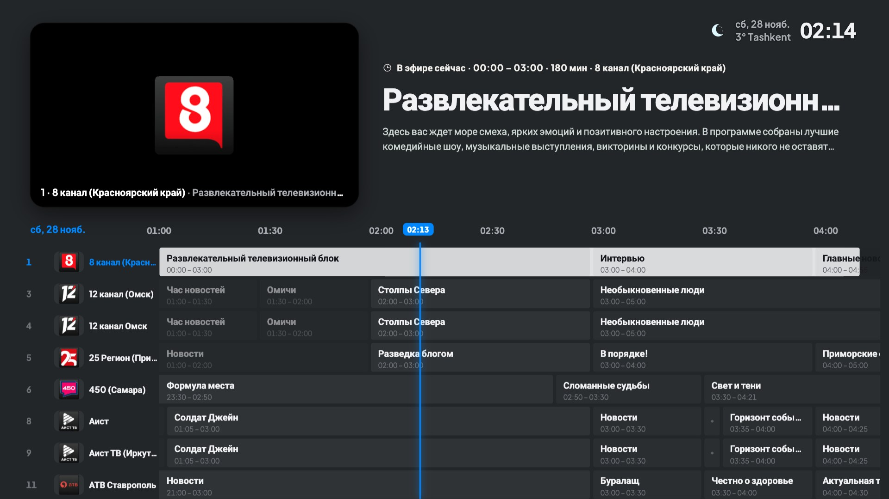 |  |
| Сетка передач по всем каналам | Светлая тема |

**Плеер**

| | |
|:-:|:-:|
| 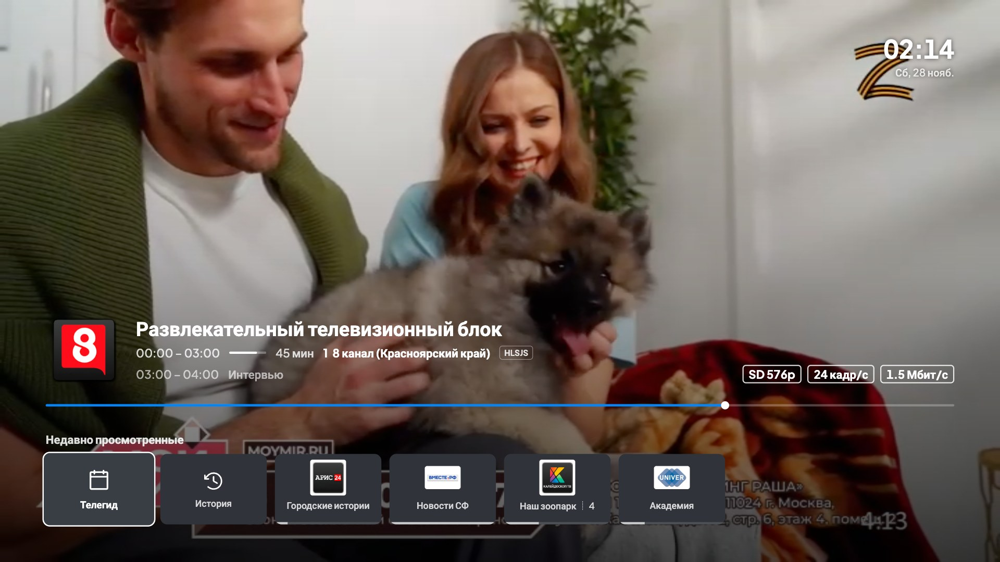 | 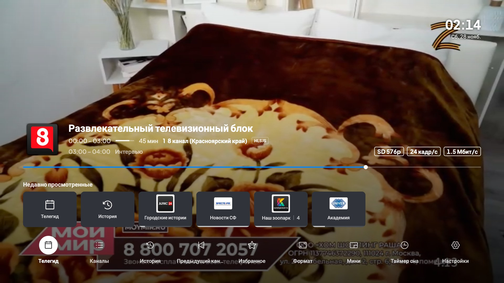 |
| Передача, шкала, недавно просмотренные | Кнопки управления |
| 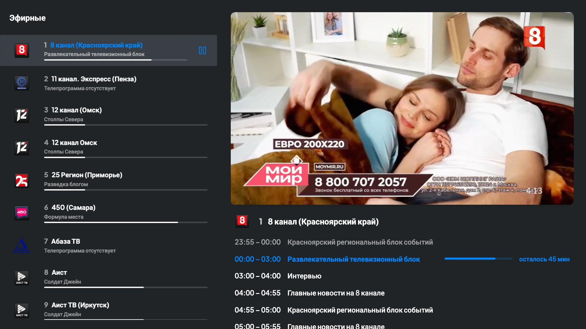 | 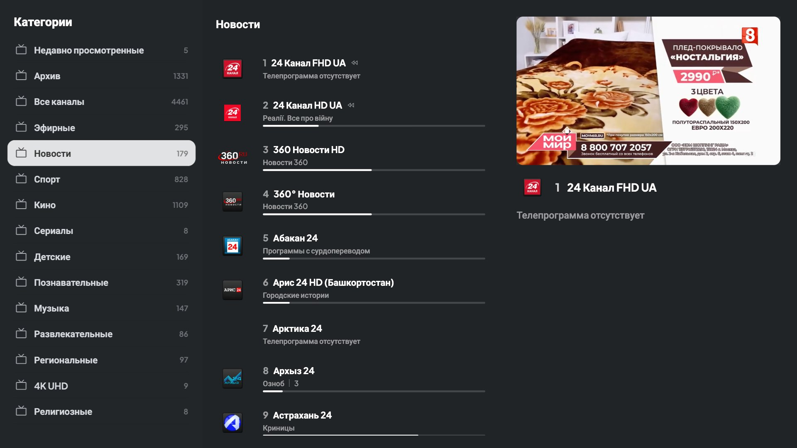 |
| Каналы поверх эфира с программой канала | Категории в плеере, эфир не прерывается |

**Настройки**

| | |
|:-:|:-:|
| 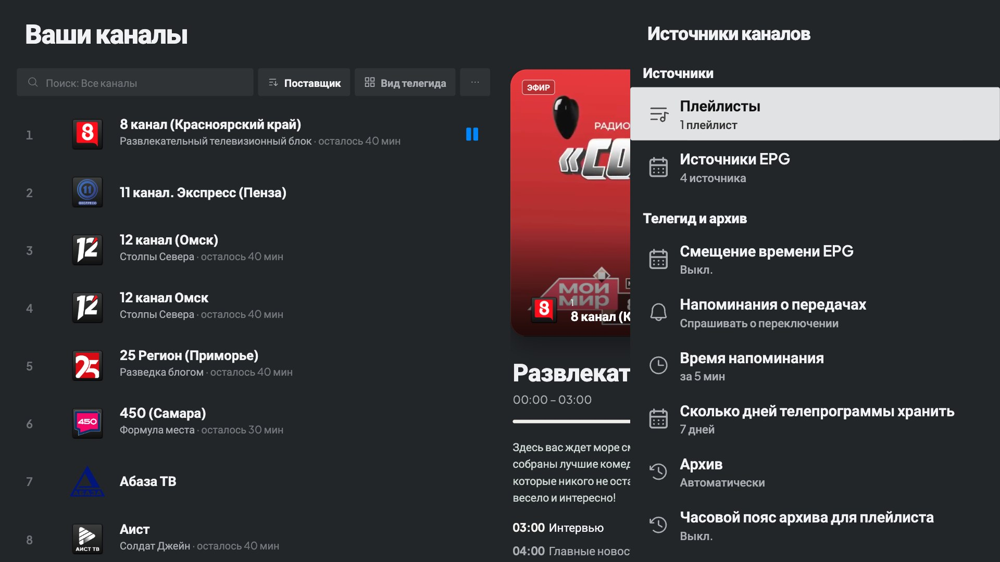 | 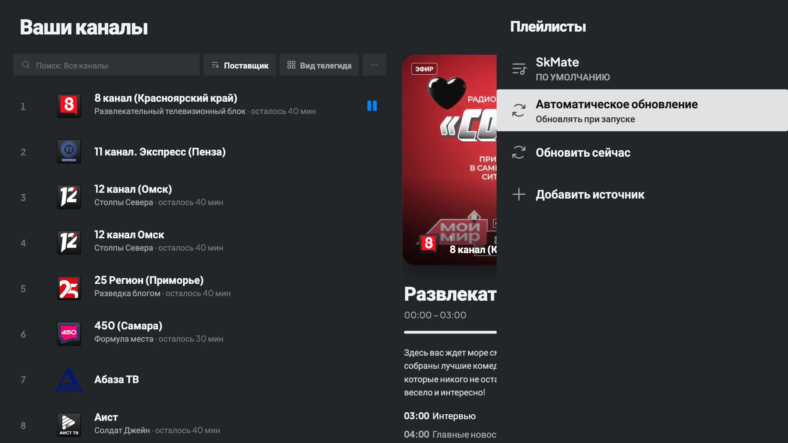 |
| Источники, телегид и архив | Плейлисты и их обновление |
| 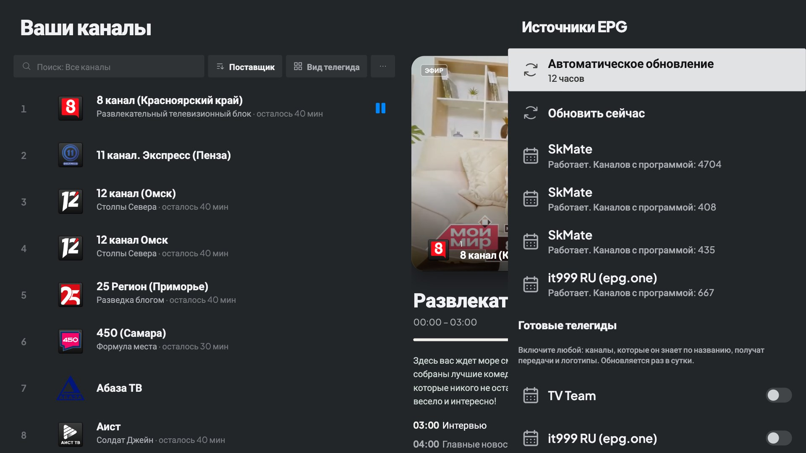 | 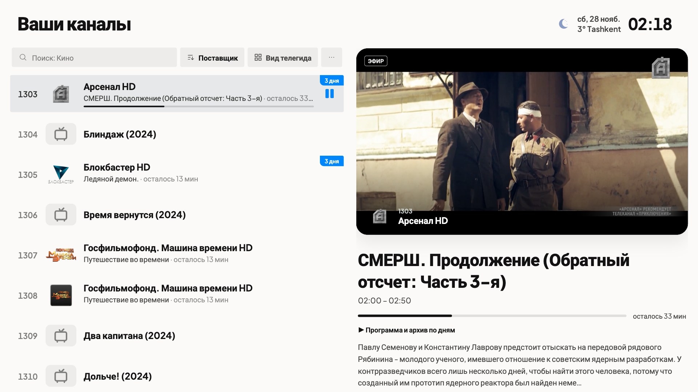 |
| Источники EPG и их обновление | Светлая тема |

## Установка

**Samsung (Tizen)** через TizenBrew, [пошаговая инструкция](docs/install-samsung.md):
1. На телевизоре: «Приложения» → набрать 12345 → Developer mode: On, IP компьютера → перезагрузить телевизор.
2. На компьютере: скачать [TizenBrew Installer](https://github.com/reisxd/TizenBrewInstaller/releases/latest) и нажать **Install TizenBrew**.
3. В TizenBrew Installer: установка **с GitHub** → `swensi17/skmate-tv`.

**LG (webOS)** через режим разработчика, [пошаговая инструкция](docs/install-lg.md):
1. Аккаунт разработчика LG: https://webostv.developer.lge.com
2. На телевизоре: LG Content Store → **Developer Mode** → войти → Dev Mode Status: On → Key Server: On.
3. На компьютере: [webOS Dev Manager](https://github.com/webosbrew/dev-manager-desktop/releases/latest) → добавить телевизор → установить [SkMate-IPTV-webos.ipk](https://github.com/swensi17/skmate-tv/releases/latest/download/SkMate-IPTV-webos.ipk).

Обновление ставится поверх, плейлисты и настройки сохраняются.

## Telegram

  
  
  

- [Канал @skmates](https://t.me/skmates): выпуски и новости.
- [Чат @skmatetv](https://t.me/skmatetv): вопросы, помощь с установкой, пожелания.
- [Автор @swensi17](https://t.me/swensi17).

## Частые вопросы

**Есть ли в приложении каналы?** Нет. Это плеер: вы добавляете свой плейлист M3U или Xtream Codes.

**Почему не в магазине Samsung?** Магазин Samsung выпускает приложения сторонних разработчиков без партнёрского договора только в США. Поэтому на Samsung и LG приложение ставится через режим разработчика телевизора, это делается один раз.

**Какие телевизоры Samsung подходят?** Tizen 4.0 и новее, то есть модели с 2018 года. Подробно в [инструкции](docs/install-samsung.md).

**Нужно ли что-то делать с LG после установки?** Режим разработчика LG действует 1000 часов. Продлите его кнопкой EXTEND в приложении Developer Mode, иначе телевизор удалит приложения разработчика. [Инструкция](docs/install-lg.md).

**Где архив передач?** На экране каналов нажмите ▶ на канале с отметкой архива: справа откроется его программа с днями. OK на прошедшей передаче включает запись.

**Программа не совпадает с каналом.** Откройте «Источники каналов» → «Источники EPG» и проверьте порядок: у канала берётся верхний телегид, где есть передачи. Кнопка «Обновить сейчас» скачает телегид заново.

**А Android TV, Google TV, Fire TV?** Отдельная версия: [swensi17/skmate-iptv](https://github.com/swensi17/skmate-iptv).

## Безопасность

Выпуск для Samsung — файл `.wgt` без подписи: при установке TizenBrew Installer подписывает его сертификатом вашего телевизора. Выпуск для LG — файл `.ipk` с ID `uz.skmate.iptv`. Контрольные суммы SHA-256 указаны в описании каждого выпуска. Исходный код открыт: ветка [`lg-tizen`](https://github.com/swensi17/skmate-iptv/tree/lg-tizen/web) репозитория skmate-iptv.

## Ответственность за контент

SkMate IPTV — только плеер. Приложение не содержит и не предоставляет каналы, плейлисты или подписки. Пользователь сам отвечает за источники, которые добавляет.

## Конфиденциальность

[Политика конфиденциальности](docs/privacy.md): аккаунт не нужен, рекламы и аналитики нет, плейлисты и настройки хранятся только на телевизоре.

## Лицензия

[GPL-3.0-or-later](LICENSE).

Ключевые слова: IPTV player, Samsung Smart TV, Tizen, TizenBrew, LG webOS, M3U, M3U8, Xtream Codes, EPG, XMLTV, catch-up, IPTV плеер, Smart TV, телегид, архив.
