

  <picture>
    <source media="(prefers-color-scheme: dark)" srcset="docs/brand/banner-dark.png">
    
  </picture>

<h1 align="center">SkMate IPTV для Smart TV</h1>

<b>Бесплатный IPTV-плеер с открытым кодом для телевизоров Samsung (Tizen) и LG (webOS).</b> Для Android TV, Google TV и Fire TV: <a href="https://github.com/swensi17/skmate-iptv">SkMate для Android</a>. 
M3U и Xtream Codes, телегид (EPG), архив, профили — управление только пультом, без рекламы и аккаунтов. Та же программа, что и на Android TV: те же экраны, функции и настройки.

  <a href="https://t.me/skmates">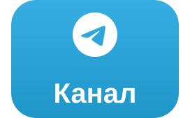</a><a href="docs/install-samsung.md">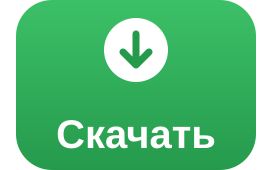</a>

  
  
  
  

  
  
  
  
  

<a href="https://github.com/swensi17/skmate-tv/releases/latest/download/SkMate-IPTV-tizen.wgt"><b>⬇ Скачать для Samsung (.wgt)</b></a> — <a href="docs/install-samsung.md">как установить</a> · <a href="https://github.com/swensi17/skmate-iptv"><b>Android TV, Google TV, Fire TV →</b></a>

<b>Русский</b> · <a href="docs/README.en.md">English</a>

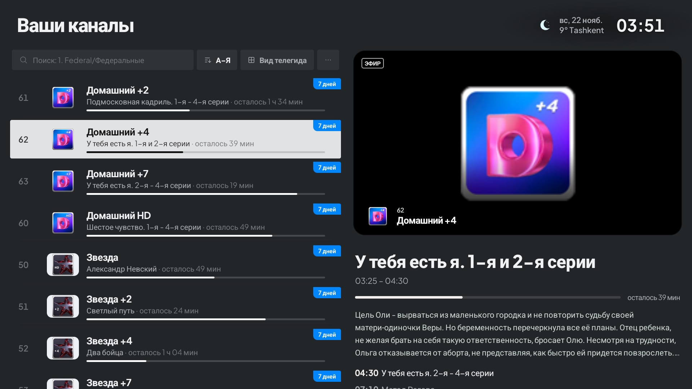

## Возможности

**Источники**
- M3U / M3U8 по ссылке, Xtream Codes; несколько плейлистов.
- Группы провайдера (`group-title`, `#EXTGRP`), избранное, недавно просмотренные.

**Телегид и архив**
- XMLTV (`url-tvg`, `.xml`, `.xml.gz`), привязка программы по названию канала, даже без `tvg-id`.
- Сетка передач по всем каналам, описание и «что дальше» прямо в списке каналов. Телегид хранится на телевизоре и открывается сразу.
- Архив (catch-up) там, где его поддерживает провайдер.

**Плеер**
- Прямой эфир играет встроенным проигрывателем телевизора (HLS, MPEG-TS), при необходимости запасными hls.js и mpegts.js.
- Звуковые дорожки и субтитры, режимы картинки.
- Переключение каналов кнопками ▲▼ и CH±, список каналов и категории поверх эфира.
- Предпросмотр канала прямо в списке.

**Интерфейс**
- Сделан под пульт: всё доступно стрелками и OK, фокус всегда виден.
- Тёмная и светлая темы, масштаб интерфейса.
- Профили, PIN-код на категории.

## Скриншоты

Экраны такие же, как в версии для Android TV.

| | |
|:-:|:-:|
|  | 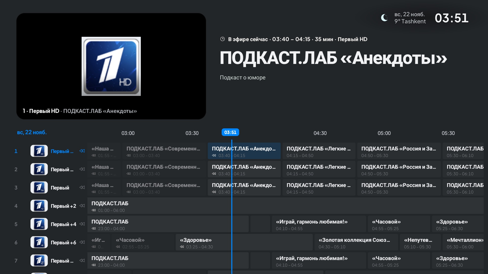 |
| **Прямой эфир**: список, предпросмотр, телепрограмма | **Телегид**: сетка передач по всем каналам |
| 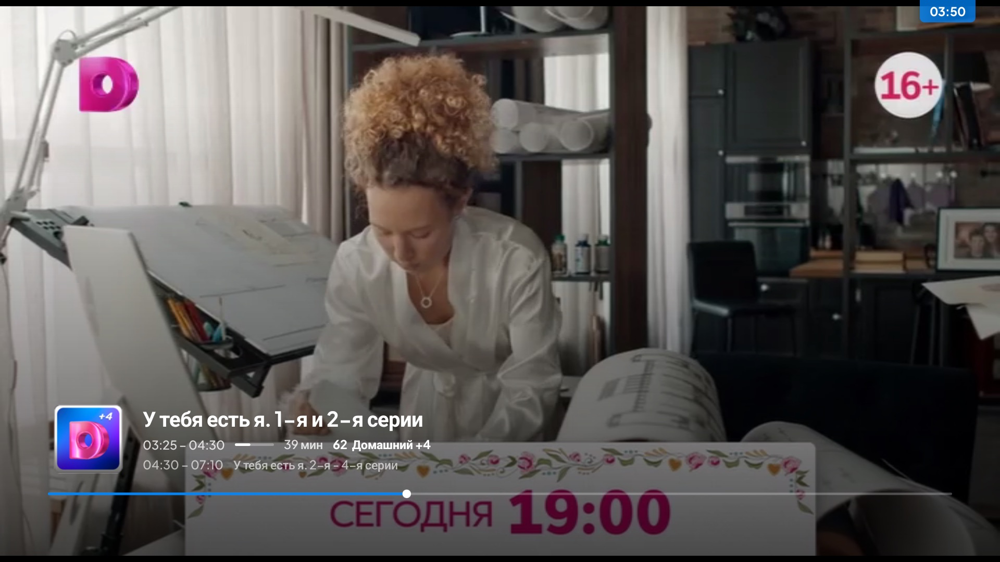 | 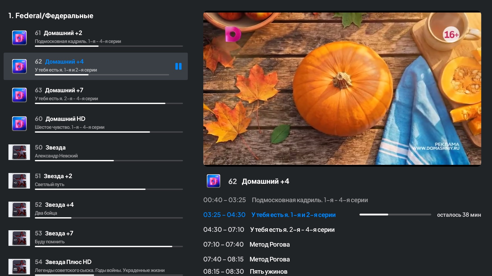 |
| **Плеер**: передача, время, прогресс, что дальше | **Каналы поверх эфира** с расписанием канала |
| 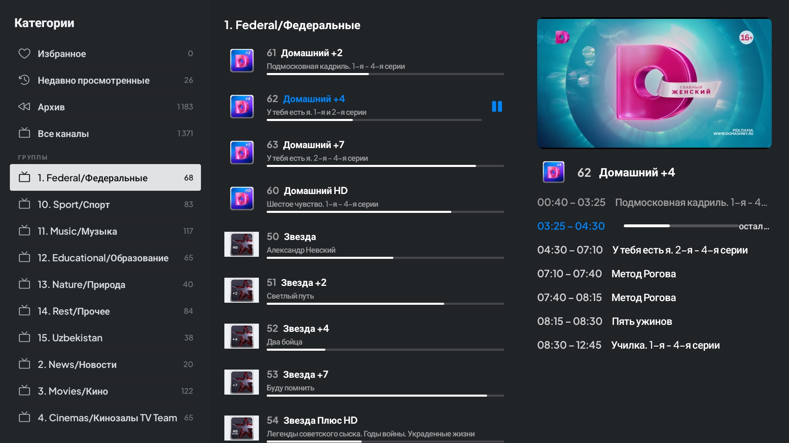 | 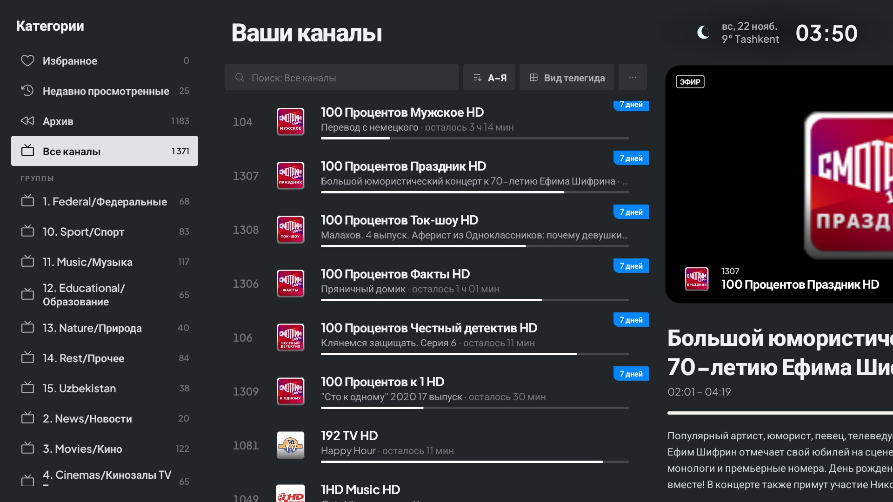 |
| **Категории в плеере**, картинка не прерывается | **Категории** в списке каналов |
| 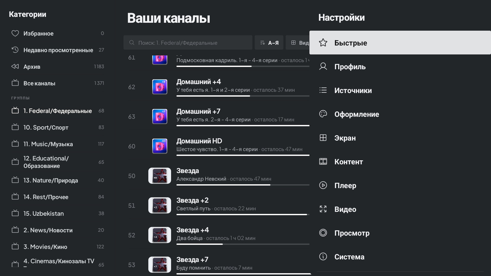 | 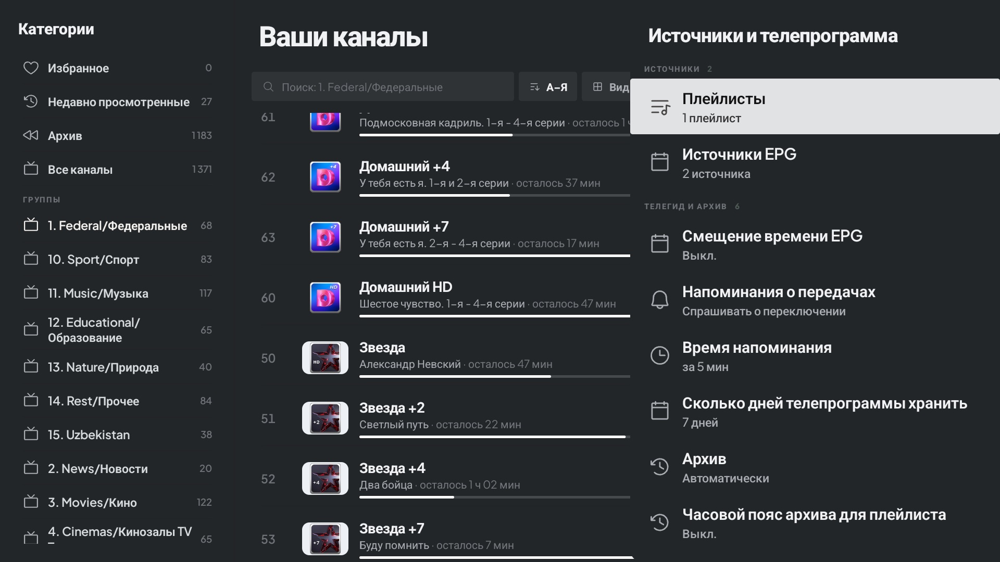 |
| **Настройки** — боковая панель поверх эфира | **Источники и телепрограмма (EPG)**, архив |
|  | 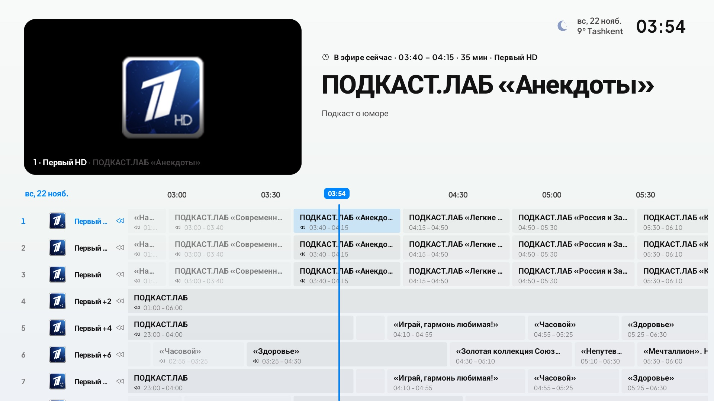 |
| **Светлая тема** | **Телегид в светлой теме** |

## Частые вопросы

**Есть ли в приложении каналы?** Нет. Это только плеер: вы добавляете свой M3U или Xtream Codes.
**Почему не в магазине Samsung?** Магазин Samsung выпускает приложения сторонних разработчиков без партнёрского договора только в США. Поэтому SkMate ставится через TizenBrew, это занимает около 10 минут один раз.
**Какие телевизоры Samsung подходят?** Tizen 4.0 и новее (модели с 2018 года). Проверено на модели 2019 года. Подробно — в [инструкции](docs/install-samsung.md).
**А LG?** Версия для LG готовится к выпуску в магазин LG: [подробности](docs/install-lg.md).
**А Android TV, Google TV, Fire TV?** Отдельная версия: [swensi17/skmate-iptv](https://github.com/swensi17/skmate-iptv).

## Установка

**Samsung (Tizen):** через TizenBrew — [пошаговая инструкция](docs/install-samsung.md).
1. На телевизоре: «Приложения» → набрать 12345 → Developer mode: On, IP компьютера → перезагрузить ТВ.
2. На компьютере: скачать [TizenBrew Installer](https://github.com/reisxd/TizenBrewInstaller/releases/latest) и нажать **Install TizenBrew**.
3. В TizenBrew Installer: установка **с GitHub** → `swensi17/skmate-tv`.

**LG (webOS):** [готовим](docs/install-lg.md).

## Безопасность

Каждый выпуск — файл `.wgt`, подписанный одним и тем же сертификатом автора «SkMate» (распространитель — стандартный Tizen Public Distributor), поэтому обновление ставится поверх. Контрольная сумма SHA-256 указана в описании каждого выпуска.

## Ответственность за контент

SkMate IPTV — только плеер. Приложение не содержит и не предоставляет каналы, плейлисты или подписки. Пользователь сам отвечает за источники, которые добавляет.

## Лицензия

[GPL-3.0-or-later](LICENSE). Исходный код: [swensi17/skmate-iptv](https://github.com/swensi17/skmate-iptv), версия для телевизоров — ветка [`darsaec/lg`](https://github.com/swensi17/skmate-iptv/tree/darsaec/lg/web).

## Мы в сети

[Telegram](https://t.me/swensi17) · [X](https://x.com/swensi17) · [GitHub](https://github.com/swensi17)

Ключевые слова: IPTV player, Samsung Smart TV, Tizen, TizenBrew, LG webOS, M3U, M3U8, Xtream Codes, EPG, XMLTV, catch-up, IPTV плеер, Smart TV, телегид.
