

  <picture>
    <source media="(prefers-color-scheme: dark)" srcset="brand/banner-dark.png">
    
  </picture>

<h1 align="center">SkMate IPTV for Smart TV</h1>

<b>A free, open-source IPTV player for Samsung (Tizen) and LG (webOS) TVs.</b> 
M3U and Xtream Codes, TV guide (EPG), catch-up, profiles. Made for the remote, no ads, no account. 
The same app as <a href="https://github.com/swensi17/skmate-iptv">SkMate for Android TV, Google TV and Fire TV</a>: the same screens, features and settings.

  
  
  
  
  
  
  
  

<a href="../README.md">Русский</a> · <b>English</b>

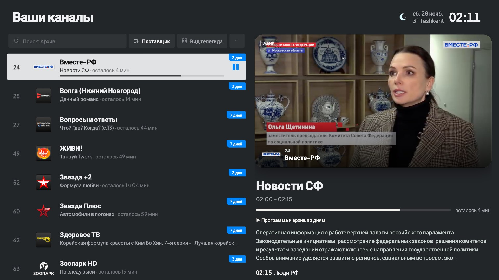

## Download

<table align="center">
  <tr>
    <td align="center" valign="top" width="33%">
      <a href="https://github.com/swensi17/skmate-tv/releases/latest/download/SkMate-IPTV-tizen.wgt">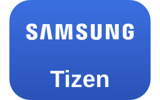</a> 
      Samsung, Tizen 4.0 or later <code>.wgt</code> · <a href="install-samsung.md">install</a>
    </td>
    <td align="center" valign="top" width="33%">
      <a href="https://github.com/swensi17/skmate-tv/releases/latest/download/SkMate-IPTV-webos.ipk">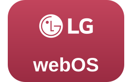</a> 
      LG, webOS 4.0 or later <code>.ipk</code> · <a href="install-lg.md">install</a>
    </td>
    <td align="center" valign="top" width="33%">
      <a href="https://github.com/swensi17/skmate-iptv/releases/latest/download/SkMate-IPTV.apk">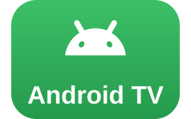</a> 
      Android TV, Google TV, Fire TV <code>.apk</code> · <a href="https://github.com/swensi17/skmate-iptv">repository</a>
    </td>
  </tr>
</table>

All releases and SHA-256 checksums: [Releases](https://github.com/swensi17/skmate-tv/releases).

## Devices

| Platform | Versions | File | How it is installed |
|:--|:--|:--|:--|
| Samsung Smart TV | Tizen 4.0 or later (2018 models and newer) | `SkMate-IPTV-tizen.wgt` | with TizenBrew, about 10 minutes, once |
| LG Smart TV | webOS 4.0 or later | `SkMate-IPTV-webos.ipk` | with Developer Mode and webOS Dev Manager, about 15 minutes |
| Android TV, Google TV, Fire TV | Android 8.0 or later | `SkMate-IPTV.apk` | as an ordinary app |

## Features

**Sources**
- M3U and M3U8 by link, Xtream Codes, several playlists.
- Automatic playlist update: at start or every 2, 6, 12, 24 or 48 hours, plus "Update now".
- Provider groups, favourites, recently watched.

**TV guide and catch-up**
- XMLTV from the playlist header (`url-tvg`) and your own sources, `.xml` and `.xml.gz`.
- Programmes are matched by `tvg-id`, or by name when there is none. One guide per channel: the topmost source that has programmes for it.
- Automatic guide update: at start or every 1, 3, 6, 12, 24 or 48 hours. The guide also updates after the playlist does.
- A grid of programmes across all channels.
- A channel's programme with ▶, as a column beside the list: days on the right, catch-up as far back as the provider keeps it (up to 7 days). OK on an aired programme plays the recording.

**Player**
- Live TV on the TV's own player (HLS, MPEG-TS), with hls.js and mpegts.js as fallbacks.
- Programme info, a row of recently watched channels, controls: guide, channels, history, favourite, aspect, sleep timer.
- A seek bar |◀ ◀◀ ⏸ ▶▶ ▶| and back to live on channels with catch-up.
- Channels and categories over the picture: the list follows the category the cursor rests on, the picture keeps playing.
- Audio tracks and subtitles, stream details (resolution, frame rate, codec, bitrate).

**Interface**
- Built for the remote: everything is reachable with the arrows and OK, the focus is always visible.
- Categories without OK: the channel list follows the cursor.
- At start the cursor is on the channel and in the category where it was when you left.
- Dark and light themes, scaling, 24 languages. Profiles and a PIN for categories.
- On LG the app can start with the TV and open the last channel.

## Screenshots

**Channels and programme**

| | |
|:-:|:-:|
|  | 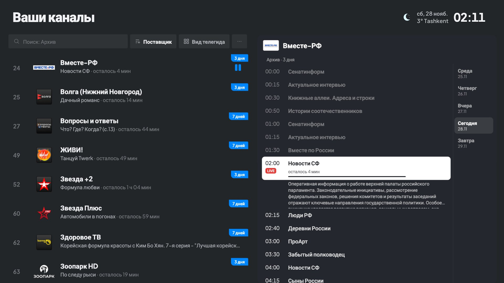 |
| Channel list, preview and what is on | A channel's programme as a column beside the list |
| 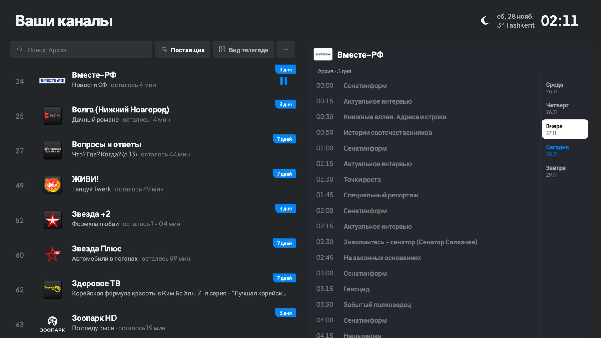 | 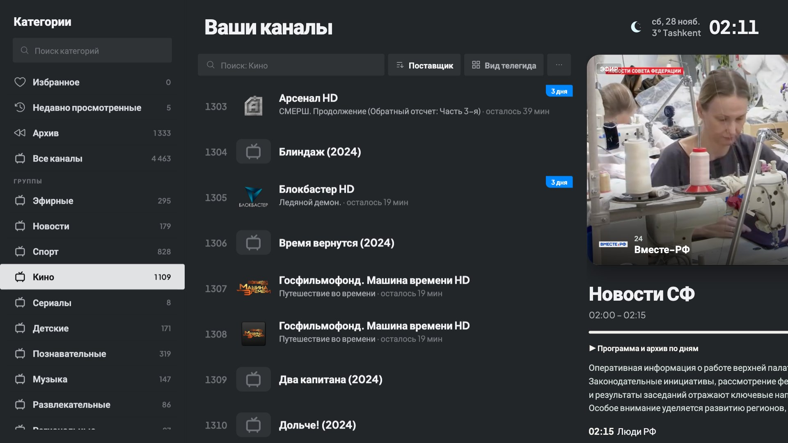 |
| Catch-up days beside the programmes | Categories: the list follows without OK |

**TV guide**

| | |
|:-:|:-:|
| 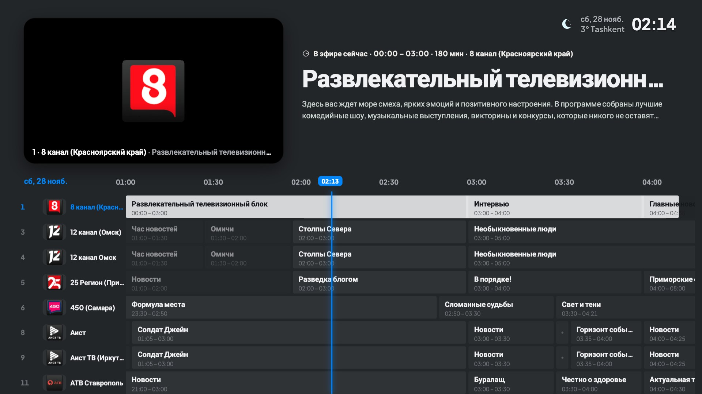 | 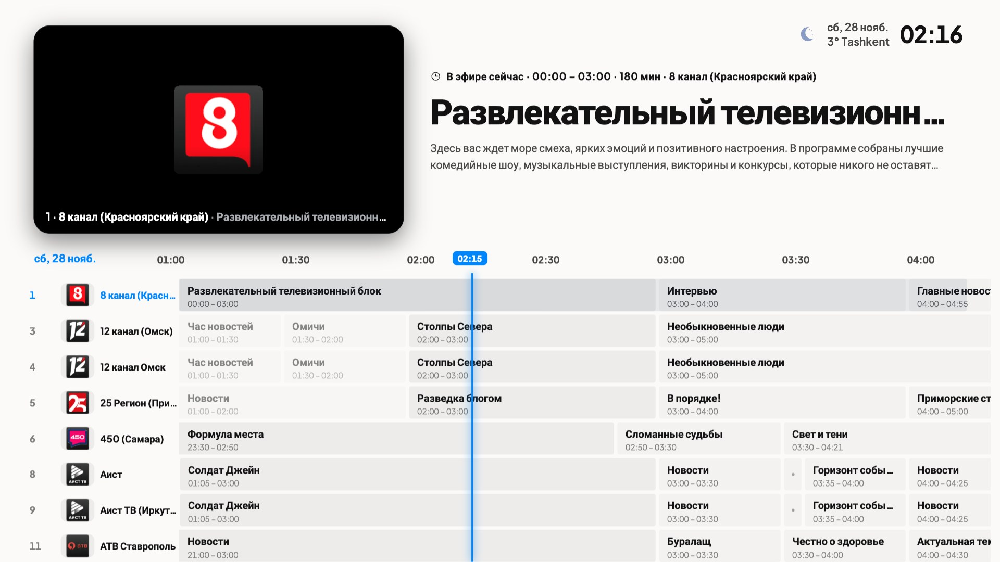 |
| Programme grid across all channels | Light theme |

**Player**

| | |
|:-:|:-:|
| 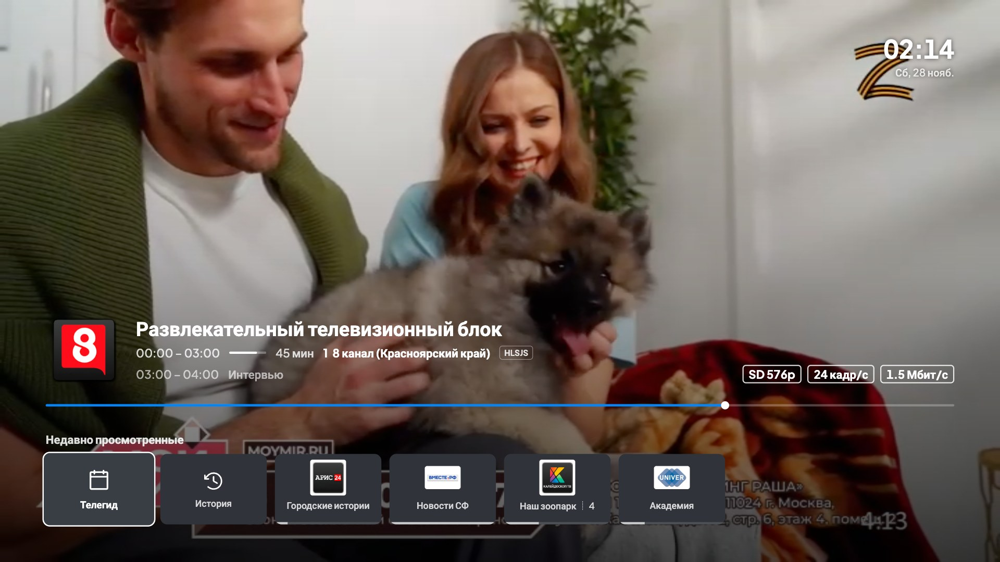 | 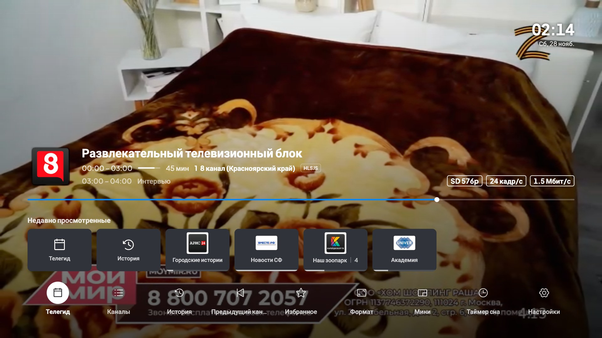 |
| Programme, seek bar, recently watched | Controls |
| 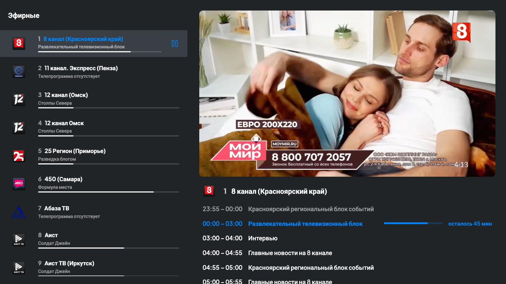 | 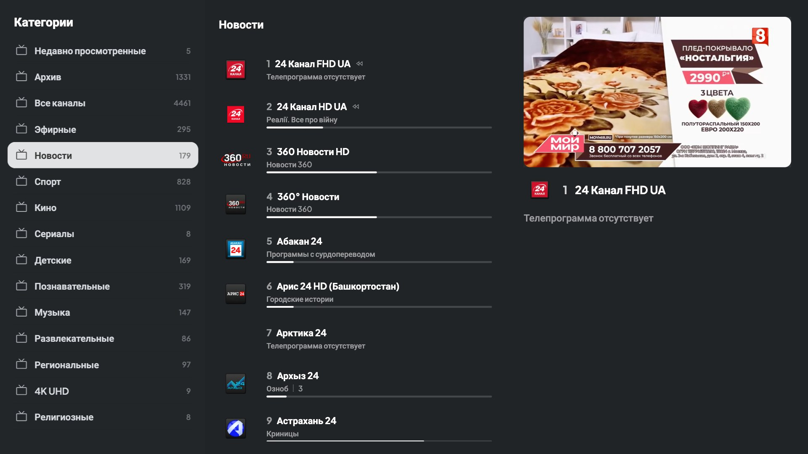 |
| Channels over the picture with the channel's programme | Categories in the player, the picture keeps playing |

**Settings**

| | |
|:-:|:-:|
| 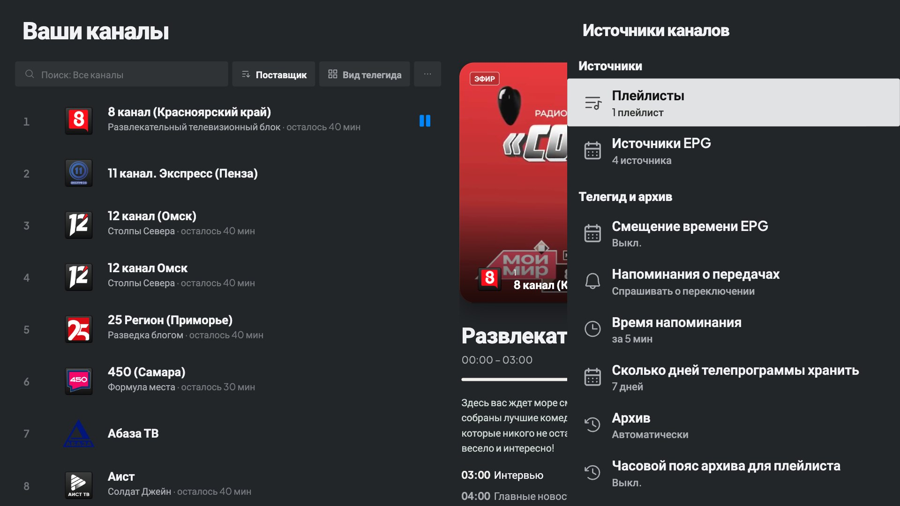 | 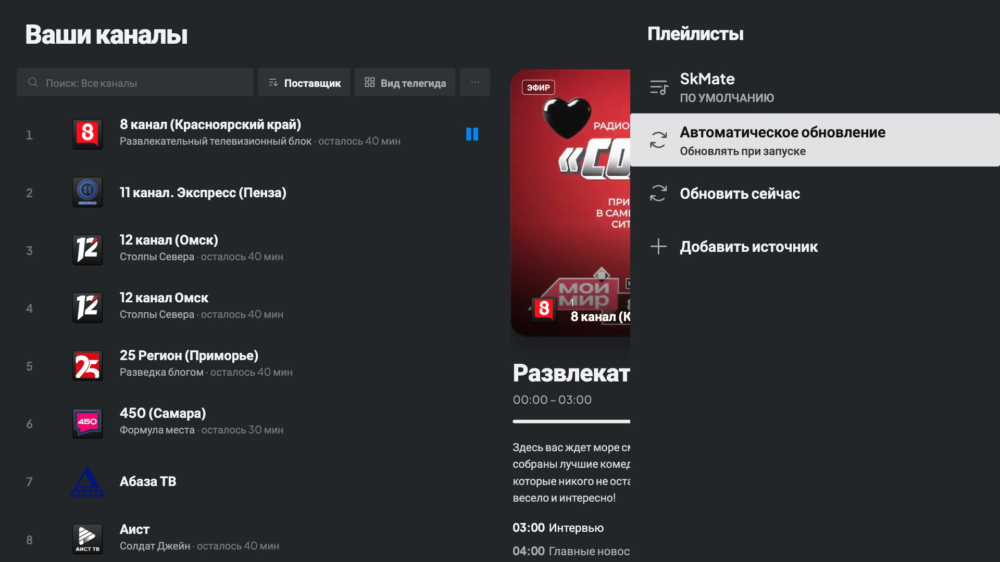 |
| Sources, guide and catch-up | Playlists and their update |
| 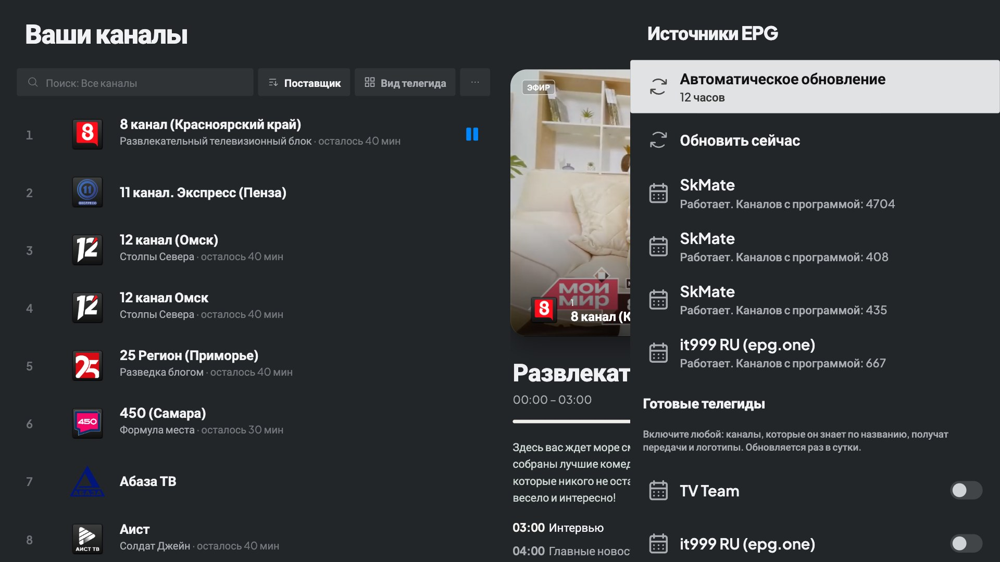 | 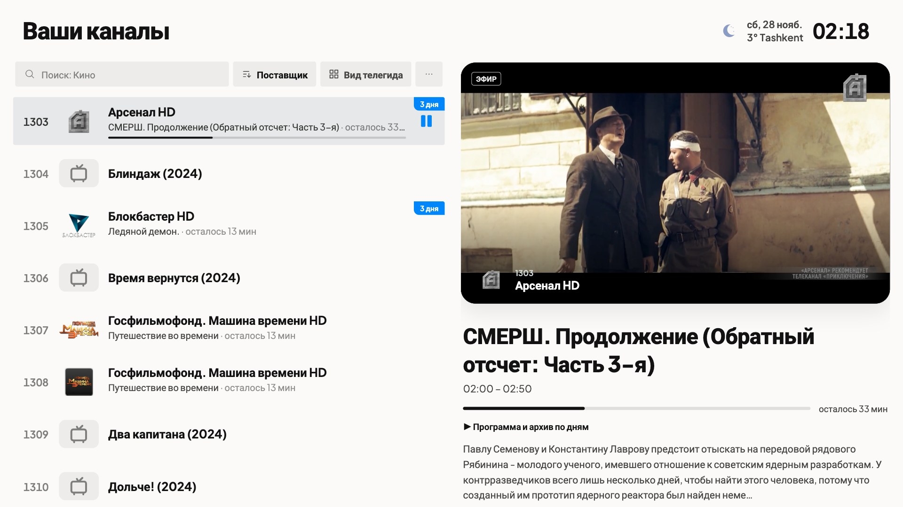 |
| EPG sources and their update | Light theme |

## Installation

**Samsung (Tizen)** with TizenBrew, [step by step](install-samsung.md):
1. On the TV: Apps → type 12345 → Developer mode: On, your computer's IP → restart the TV.
2. On the computer: download [TizenBrew Installer](https://github.com/reisxd/TizenBrewInstaller/releases/latest) and press **Install TizenBrew**.
3. In TizenBrew Installer: install **from GitHub** → `swensi17/skmate-tv`.

**LG (webOS)** with Developer Mode, [step by step](install-lg.md):
1. An LG developer account: https://webostv.developer.lge.com
2. On the TV: LG Content Store → **Developer Mode** → sign in → Dev Mode Status: On → Key Server: On.
3. On the computer: [webOS Dev Manager](https://github.com/webosbrew/dev-manager-desktop/releases/latest) → add the TV → install [SkMate-IPTV-webos.ipk](https://github.com/swensi17/skmate-tv/releases/latest/download/SkMate-IPTV-webos.ipk).

An update installs over the previous version; playlists and settings are kept.

## Telegram

  
  
  

- [Channel @skmates](https://t.me/skmates): releases and news.
- [Chat @skmatetv](https://t.me/skmatetv): questions, help with installation, suggestions.
- [Author @swensi17](https://t.me/swensi17).

## FAQ

**Does the app come with channels?** No. It is a player: you add your own M3U playlist or Xtream Codes account.

**Why is it not in the Samsung store?** The Samsung store publishes third-party apps without a partner agreement only in the US. So on Samsung and LG the app is installed through the TV's developer mode, once.

**Which Samsung TVs work?** Tizen 4.0 or later, that is 2018 models and newer. Details in the [guide](install-samsung.md).

**Anything to do on LG after installing?** LG Developer Mode lasts 1000 hours. Extend it with the EXTEND button in the Developer Mode app, or the TV removes developer apps. [Guide](install-lg.md).

**Where is catch-up?** On the channels screen press ▶ on a channel with the catch-up mark: its programme opens on the right with the days. OK on an aired programme plays the recording.

**The programme does not match the channel.** Open Channel sources → EPG sources and check the order: a channel takes the topmost guide that has programmes for it. "Update now" downloads the guide again.

**And Android TV, Google TV, Fire TV?** A separate version: [swensi17/skmate-iptv](https://github.com/swensi17/skmate-iptv).

## Security

The Samsung release is an unsigned `.wgt`: TizenBrew Installer signs it with your TV's certificate while installing. The LG release is an `.ipk` with the ID `uz.skmate.iptv`. SHA-256 checksums are in every release's notes. The source is open: the [`lg-tizen`](https://github.com/swensi17/skmate-iptv/tree/lg-tizen/web) branch of skmate-iptv.

## Content

SkMate IPTV is only a player. It does not contain or provide channels, playlists or subscriptions. You are responsible for the sources you add.

## Privacy

[Privacy policy](privacy.md): no account, no ads, no analytics; playlists and settings stay on the TV.

## License

[GPL-3.0-or-later](../LICENSE).
